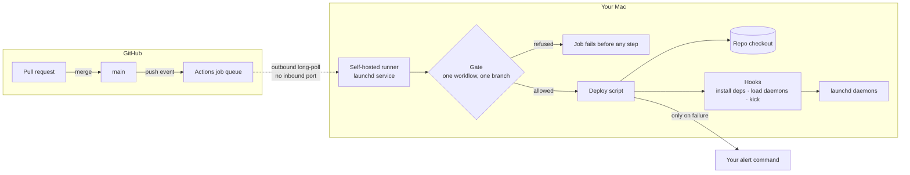
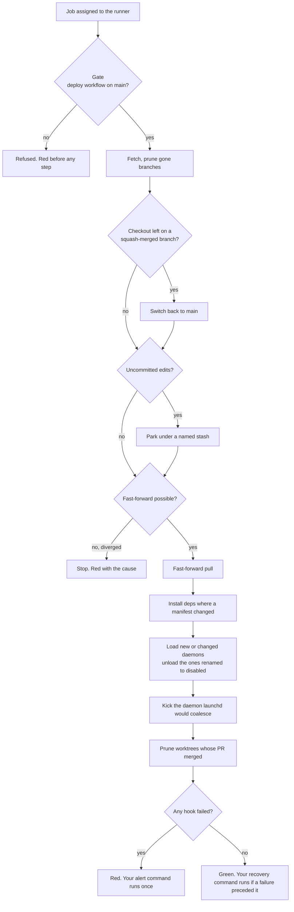

# Architecture

Two diagrams, moved here from the README: how a merge reaches the Mac, and what one deploy run does step by step. Both are reference material for CONTRIBUTING.md, not the README's shape.

## How it sits

Nothing on the Mac listens. The runner asks GitHub for work; the gate decides whether it may run.

## One deploy

Every branch off the happy path ends red with its cause.

## Rolling back

Every pull writes one `PULLED` line to the deploy log. It names the commit the checkout left (`PIERLESS_FROM_SHA`) and the commit it reached (`PIERLESS_TO_SHA`). The same two values reach the `on_failure` command as environment variables. Read the log, not the reflog, to find the commit to go back to.

**Preferred: revert on main.** Run `git revert <bad-sha>` on a branch, merge it to main, and let the next deploy fast-forward the Mac. The Mac stays on a commit that exists on origin, so no deploy refuses it.

**Manual: reset the Mac to a named commit.** Use this only when main cannot be reverted yet.

1. Run `git status` in the checkout. Edits left there are parked in a stash by the next pull, and the script never restores that stash. List parked edits with `git stash list` (entries are named `pierless park <time>`). Bring one back with `git stash apply`.
2. Run `git reset --hard <sha>` in the checkout. This runs no install or daemon hooks. Run them by hand if the commits you left changed a manifest or a plist.
3. Know what the next deploy does. A commit that is an ancestor of origin/main leaves the checkout behind, so the next deploy fast-forwards it back to the bad commit. Stop the deploy trigger, or revert on main, before you rely on the reset. A commit that is not on origin/main leaves the checkout ahead or diverged. The script then pulls nothing: ahead logs `AHEAD` and exits 0, diverged exits 4.
