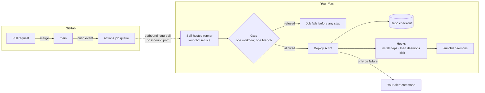
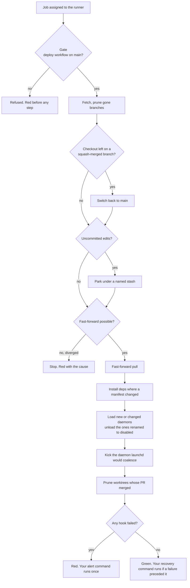

# Architecture

Two diagrams, moved here from the README: how a merge reaches the Mac, and what one deploy run does step by step. Both are reference material for CONTRIBUTING.md, not the README's shape.

## How it sits

Nothing on the Mac listens. The runner asks GitHub for work; the gate decides whether it may run.

## One deploy

Every branch off the happy path ends red with its cause.

## Rolling back

Every pulled deploy writes the commit it left and the commit it reached on its `PULLED` log line, as `PIERLESS_FROM_SHA=` and `PIERLESS_TO_SHA=`. The action also returns them as the `from_sha` and `to_sha` outputs, and the `on_failure` command gets them as `PIERLESS_FROM_SHA` and `PIERLESS_TO_SHA`. Both are empty when the run pulled nothing. To find the last good commit, read the `PULLED` line in the deploy log (`~/.pierless/deploy.log` by default).

**Preferred: revert on main.** Revert the bad commit in a pull request and merge it. The next deploy pulls the revert like any other commit, so the Mac, its hooks and its marker all move forward together. Nothing on the Mac changes by hand.

**Manual: reset the Mac to a named commit.** Use this only while the revert is not merged yet. On the Mac, in the checkout, run `git reset --hard <PIERLESS_FROM_SHA>`. Three things to know, all as the script behaves today:

- The checkout is now behind `origin/main` again. The next deploy pulls the bad commit back unless the revert is on main by then.
- The script parks uncommitted edits in a stash named `pierless park` and never restores it. A reset does not restore it either. Run `git stash list` and apply what you need by hand.
- The script refuses a checkout that has diverged from `origin/main` (exit 4, a `DIVERGED` log line). A checkout that is only ahead is left alone (an `AHEAD` log line, exit 0). Do not commit on the Mac to roll back.

The hook marker (`last-hooked-sha` in the state directory) still names the last commit whose hooks finished. Hooks do not run for a reset. Run the install or daemon steps for the older commit by hand if the bad commit changed a manifest or a daemon definition.
